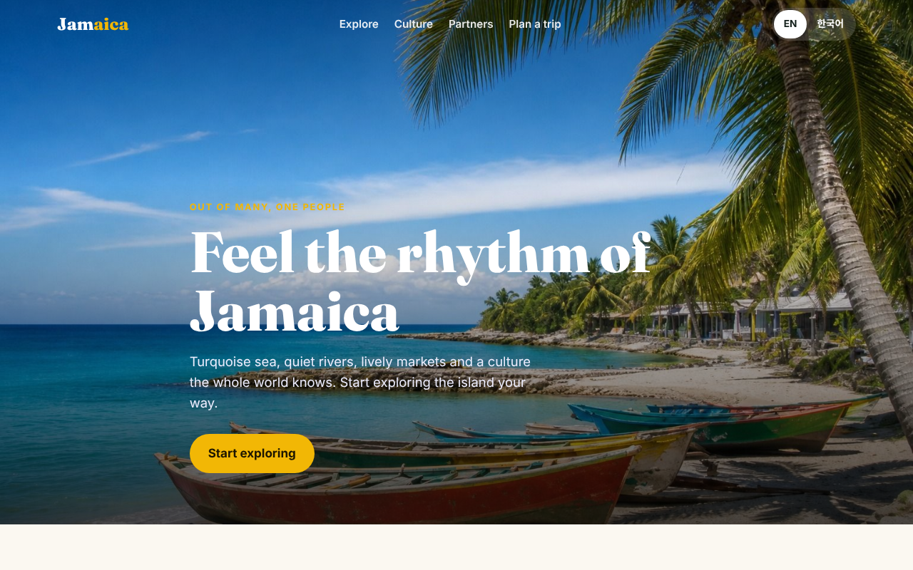

# Discover Jamaica – Interactive, Multilingual Tourism Website

> **Demo version.** A simplified build of an interactive tourism web application for Jamaica.

An interactive guide to Jamaica for international visitors, available in **English and Korean (한국어)** and aimed at travellers from the **United Kingdom** and **South Korea**.

| Home | Korean version |
|---|---|
|  |  |

## Features

- **One-click language switch** (EN / 한국어). Every heading, tab and itinerary is translated, and the choice is remembered.
- **Explore by theme:** beaches, coast, rivers, food & markets, and arriving. These are accessible tabs, so the arrow keys work too.
- **Itinerary planner:** pick how many days and what you enjoy, and it builds a day-by-day plan in your language.
- **Culture** and **international partners** sections (UK and South Korea).
- Responsive on phones and computers, with automatic dark mode.

## Tech

Plain HTML, CSS and JavaScript in one file (`index.html`), with no build step. It can be hosted on GitHub Pages.

## Run it

Open `index.html` in a browser, or turn on **Settings → Pages → Branch: main** to publish it.
